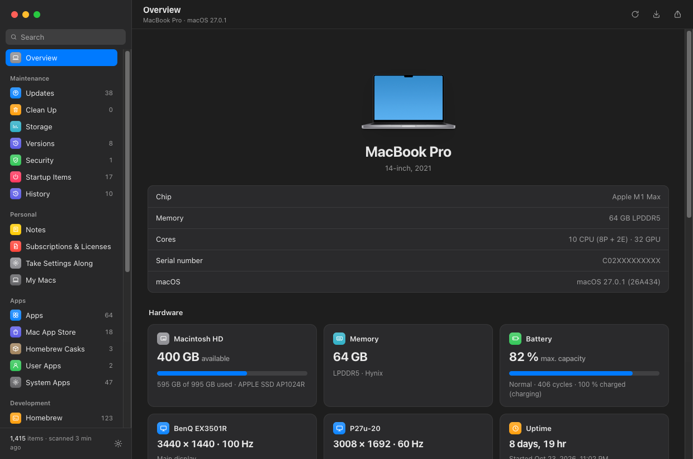
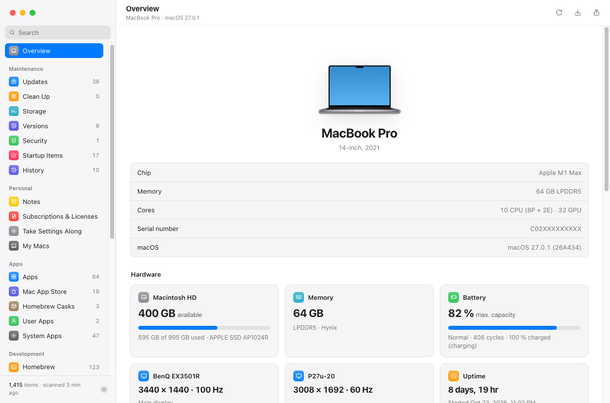
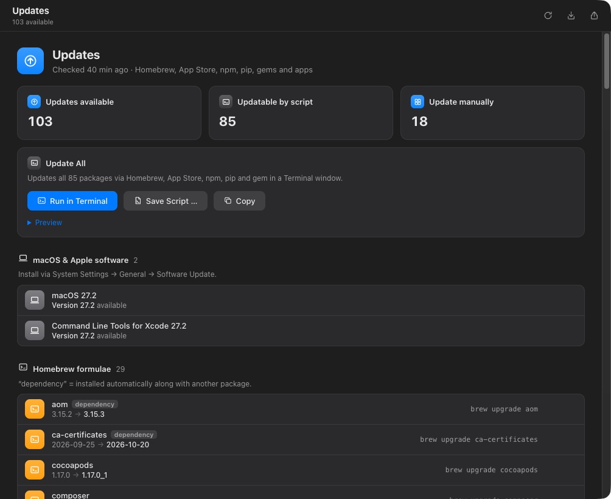
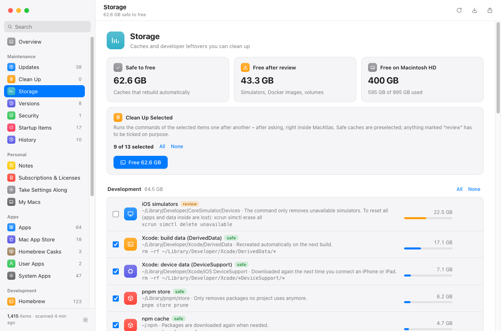
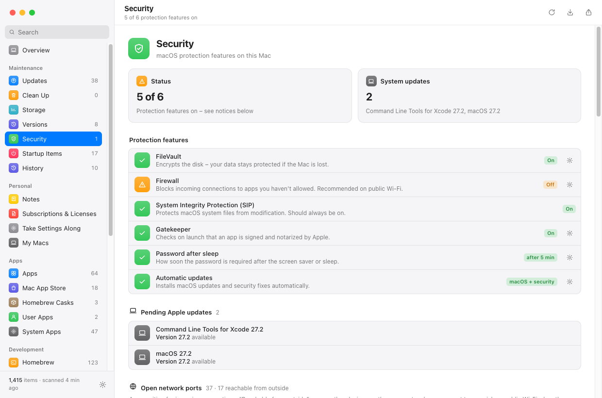
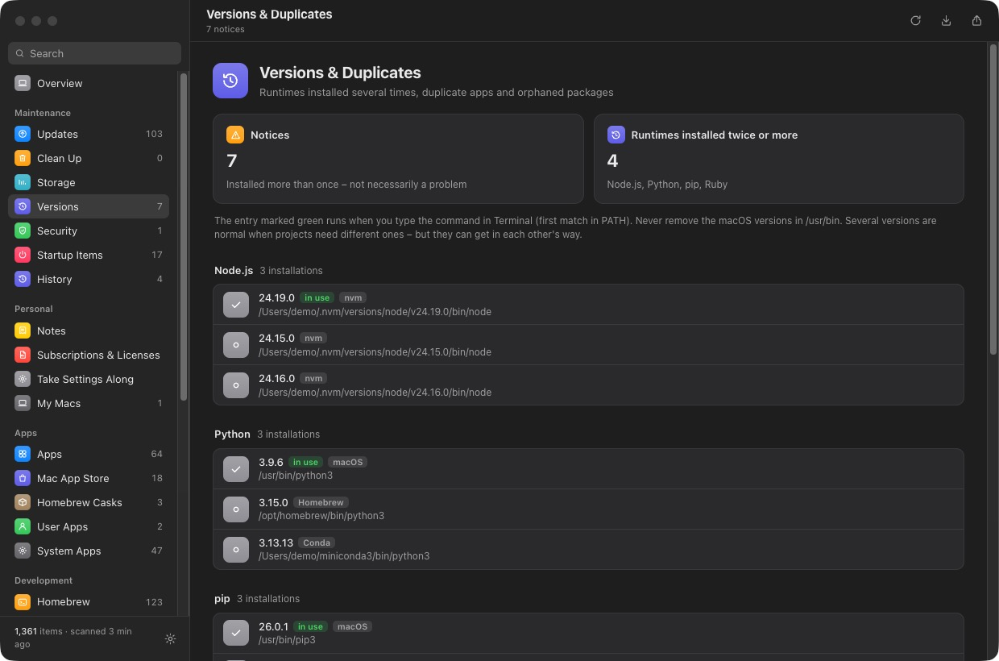
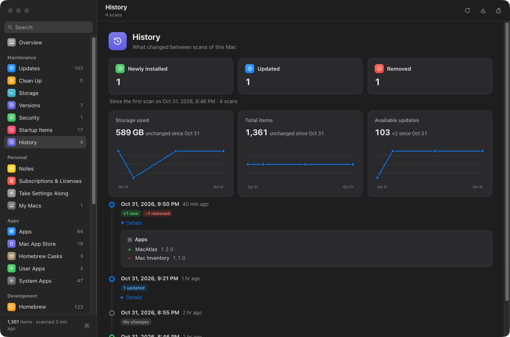
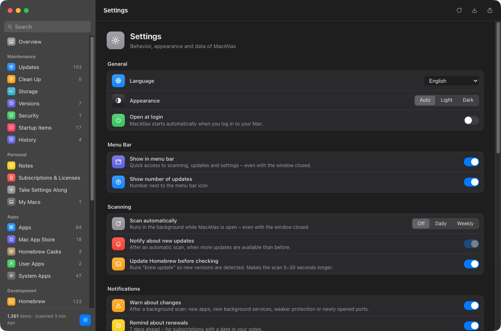

<div align="center">


# MacAtlas

**Everything on your Mac – in one place.**
Apps, Homebrew, developer tools, updates, storage, security and hardware, with an install command for every package.

[](https://github.com/m4rcelnoel/MacAtlas/actions/workflows/ci.yml)
[](https://github.com/m4rcelnoel/MacAtlas/releases)

[](LICENSE)

English · Deutsch (in-app)

</div>

<p align="center">
  
  
</p>

## Why

Setting up a new Mac, cleaning up an old one or just answering *"what did I install here?"* usually means digging through `/Applications`, `brew list`, `npm -g`, `pip`, gems, VS Code and a dozen caches. MacAtlas scans all of it in about 45 seconds, without administrator rights, and turns the result into something you can act on: updates, cleanup commands, a migration plan for your next Mac and a PDF report.

## Features

### Inventory
- Apps in `/Applications` (with Homebrew cask / App Store source detection), Mac App Store, Homebrew formulae & casks, npm, pip, Ruby gems, VS Code extensions, Docker images & containers, fonts, Claude Code plugins, skills and MCP servers.
- An install command and website for every entry, full-text search (⌘F) across everything including your notes.
- Hardware: model, chip, cores, memory, storage, battery health, displays, uptime.

### Maintenance



- **Updates** – outdated Homebrew packages, App Store apps, npm/pip/gems, pending macOS updates and apps installed outside Homebrew (checked against the Homebrew catalog). *Update All* runs one script in Terminal.
- **Storage** – Xcode DerivedData, simulators, device support files, Docker build cache, Homebrew/npm/pip/Gradle/CocoaPods caches and more, each with its size and the command to clean it. Safe caches can be cleaned in one go – MacAtlas never deletes anything itself, every command runs in Terminal after you confirm.
- **Versions & duplicates** – runtimes installed several times (Python, Node, Ruby, Java…) and which one actually runs, Homebrew packages in several versions, duplicate apps, orphaned dependencies.
- **Security** – FileVault, firewall, SIP, Gatekeeper, screen lock, automatic updates, open network ports (reachable from outside vs. local only), system and browser extensions.
- **Clean up** – size, last use, architecture (Intel-only apps) and code signature of every app.
- **Startup items** – launch agents and daemons with vendor, schedule and status.
- **History** – every scan is kept; a timeline shows what was added, updated or removed, with charts for storage, items and updates.

<p align="center">
  
  
</p>
<p align="center">
  
  
</p>

### Moving to a new Mac
- **Export / import** a scan (JSON) and **compare** two Macs: what's missing here, as an install script or a `Brewfile`.
- **Migration assistant** – step by step: Homebrew, Homebrew apps, App Store, developer packages, VS Code, manual downloads. *Check this Mac again* ticks off what's done.
- **Take settings along** – a ZIP with your shell, Git, SSH config (never keys), VS Code/Cursor settings and Dock/Finder/screenshot/trackpad preferences, plus a restore script. Values that look like passwords or tokens are replaced automatically.
- **My Macs** – optionally share every scan through an iCloud Drive folder and see all your Macs side by side.

### Personal
- **Notes & tags** on any entry, **subscriptions & licenses** with monthly/yearly totals and a reminder before renewals.
- **Exports**: JSON, Brewfile, CSV for Excel/Numbers, A4 PDF report.

### Automation
- Menu bar icon with the number of updates, scheduled scans (daily/weekly), notifications for new updates and for changes (new apps, new background services, weaker protection, newly opened ports).
- URL scheme for the Shortcuts app or Terminal:

| URL | Action |
|---|---|
| `macatlas://scan` | Scan in the background |
| `macatlas://report` | Save a PDF report to `~/Documents/MacAtlas/Reports` (German UI: `Berichte`) |
| `macatlas://csv`, `macatlas://export` | Save CSV / JSON to `~/Documents/MacAtlas/Exports` (German UI: `Exporte`) |
| `macatlas://open/<page>` | Open a page, e.g. `updates`, `storage`, `security`, `history` |

```bash
open "macatlas://scan"
```



**Settings** (⌘,): language (System/German/English), appearance (Auto/Light/Dark), open at login, menu bar, scheduled scans, notifications, sharing with other Macs, history length, reset.

## Install

1. Download `MacAtlas.dmg` from the [latest release](https://github.com/m4rcelnoel/MacAtlas/releases).
2. Drag MacAtlas into *Applications*.
3. Open it. Releases are signed with Developer ID and notarized by Apple, so it starts with a double-click.

   Building it yourself without a Developer ID gives an ad-hoc signed app – then macOS asks once: right-click → *Open* → *Open*. If macOS says the app "is damaged":

   ```bash
   xattr -dr com.apple.quarantine /Applications/MacAtlas.app
   ```

Requirements: macOS on Apple Silicon. The scanner uses the Python 3 that ships with the Xcode Command Line Tools. Homebrew, `mas`, Docker etc. are optional – whatever is installed gets scanned.

## Privacy

Everything stays on your Mac – there is no server, account or telemetry. Network access happens only through the package managers' own update checks (`brew update`/`brew outdated`, `mas outdated`, `npm outdated`, `pip list --outdated`, `gem outdated`) and a weekly download of the public Homebrew cask catalog. Data protected by macOS privacy controls (e.g. other apps' data such as Chrome extensions) is shown as *no access* instead of asking for permission. Sharing with other Macs is off by default; when turned on, scans are written to a folder you choose (iCloud Drive by default).

## Development

```bash
git clone https://github.com/m4rcelnoel/MacAtlas.git
cd MacAtlas/electron
npm ci
npm start          # run from source
npm test           # unit & static tests (Node's built-in test runner)
cd .. && python3 -m unittest discover -s tests   # scanner tests
./build.sh         # package, sign ad hoc, install to /Applications, build the DMG
./build.sh --no-install
```

### How it works

```
scan.sh  ──raw text/JSON──▶  build_inventory.py  ──inventory.json──▶  main.js  ──IPC──▶  renderer (app.js)
(shell tools: brew, mas,      (parsing, matching,                    (Electron main:    (UI, sandboxed,
 lsof, du, system_profiler)    update detection)                      menus, exports)    strict CSP)
```

| Path | Purpose |
|---|---|
| `electron/scripts/scan.sh` | Collects raw data with standard macOS/Homebrew tools into `$MI_WORKDIR/data` |
| `electron/scripts/build_inventory.py` | Turns it into `inventory.json` (runs on the system Python 3.9) |
| `electron/main.js` | Electron main process: window, menus, menu bar, scans, exports, sharing, URL scheme, notifications |
| `electron/lib/core.js` | Pure, unit-tested helpers (Brewfile, CSV, secret redaction, history, renewals) |
| `electron/preload.js` | Minimal IPC bridge for the sandboxed renderer |
| `electron/renderer/` | UI (`index.html`, `app.js`) and English translations (`i18n.js`, keys are the German source strings) |
| `electron/test/`, `tests/` | JavaScript and Python tests |
| `build.sh`, `make_icon.py` | Build/sign/DMG script and icon generator |

App data lives in `~/Library/Application Support/MacAtlas/` (`scan/`, `history/`, `snapshots/`, `notes.json`, `settings.json`).

### Security notes
- The renderer is sandboxed with context isolation, a strict CSP (no inline scripts) and blocked navigation.
- Imported snapshots are treated as untrusted: only plain package tokens make it into generated scripts and Brewfiles, CSV cells can't become formulas, and every value is HTML-escaped.
- Cleanup and update commands are fixed strings defined in the app and always run in a visible Terminal window after confirmation.

### CI/CD

GitHub Actions runs on every push and pull request: JavaScript tests and lint, ShellCheck, Python tests on the macOS system Python and on Python 3.12, and an ad-hoc signed DMG build on an Apple Silicon runner (uploaded as an artifact). Pushing a tag like `v1.2.0` publishes a GitHub Release with the DMG attached.

### Signing & notarization (optional)

With an Apple Developer membership the app is signed with Developer ID and notarized by Apple – it then opens with a double-click on any Mac, without warnings.

**One-time setup**

1. Create a *Developer ID Application* certificate: Xcode → Settings → Accounts → your team → Manage Certificates → **+** → *Developer ID Application* (requires the Account Holder role). It lands in your login keychain.
2. Store notarization credentials (uses an [app-specific password](https://account.apple.com)):

   ```bash
   xcrun notarytool store-credentials macatlas-notary --apple-id <apple-id> --team-id <TEAMID>
   ```

**Local build**

```bash
MACATLAS_SIGN_ID="Developer ID Application: Name (TEAMID)" MACATLAS_NOTARY_PROFILE=macatlas-notary ./build.sh
```

**CI** – add these repository secrets (Settings → Secrets and variables → Actions) and every build is signed and notarized automatically; without them CI produces an ad-hoc signed DMG:

| Secret | Content |
|---|---|
| `MACOS_CERT_P12` | Developer ID certificate + private key exported from Keychain Access as `.p12`, base64-encoded (`base64 -i cert.p12 \| pbcopy`) |
| `MACOS_CERT_PASSWORD` | Password chosen when exporting the `.p12` |
| `NOTARY_KEY_P8` | Content of an App Store Connect API key (`AuthKey_XXXX.p8`, role *Developer*) |
| `NOTARY_KEY_ID` | The key's ID |
| `NOTARY_ISSUER_ID` | Issuer ID shown on the App Store Connect *Keys* page |

`build.sh` signs with the hardened runtime (`electron/entitlements.plist`), notarizes app and DMG and staples the tickets.

## License

[MIT](LICENSE) © m4rcelnoel
